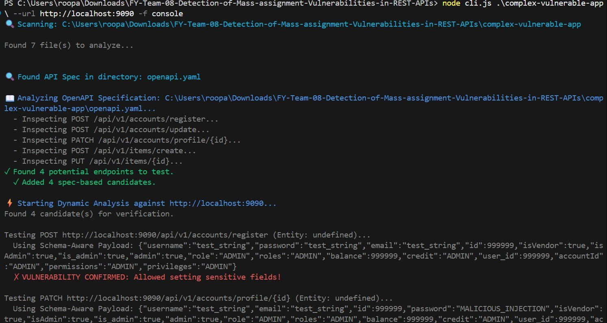
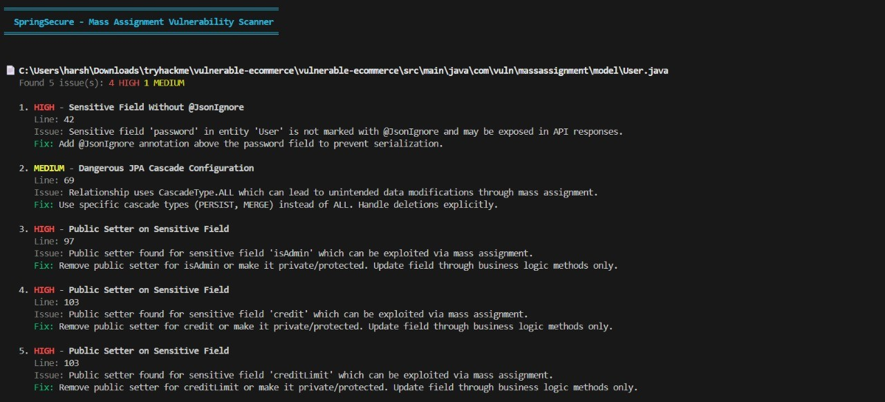

# Example output — console transcripts

These transcripts are from the §5.3 walkthrough of the Round 2 manuscript.
They were cut from the 12-page paper for length and are preserved here
verbatim. They come from the reduced seven-file subset used for the
walkthrough, not the full CVA evaluation.

## 1. CLI scan — dynamic scan initialization

Paper Fig. 4: "CLI output: dynamic scan initialization. The tool detects
openapi.yaml, inspects five endpoints, and queues four candidates for
injection testing. Output is from the reduced seven-file subset, not the
full CVA evaluation."



```
node cli.js .\complex-vulnerable-app \
--url http://localhost:9090 -f console

Scanning: ...\complex-vulnerable-app Found 7 file(s) to analyze...
Found API Spec in directory: openapi.yaml
Inspecting POST /api/v1/accounts/register
Inspecting POST /api/v1/accounts/update
Inspecting PATCH /api/v1/accounts/profile/{id}
Inspecting POST /api/v1/items/create
Inspecting PUT /api/v1/items/{id} Found 4 potential endpoints to test. Added 4 spec-based candidates.
```

## 2. Confirmed endpoint — mass assignment confirmed

```
Starting Dynamic Analysis against http://localhost:9090... Found 4 candidate(s) for verification.

Testing POST http://localhost:9090/api/v1/accounts/register... Using Schema-Aware Payload:
{
"username":"test_string", "password":"test_string", "email":"test_string","id":999999, "isVendor":true,"isAdmin":true,
"is_admin":true,"admin":true,
"role":"ADMIN","roles":"ADMIN",
"balance":999999,"credit":"ADMIN", "user_id":999999,"accountId":"ADMIN", "permissions":"ADMIN","privileges":"ADMIN"
}

X VULNERABILITY CONFIRMED: Allowed setting sensitive fields!
```

## 3. Cleared endpoint — injection rejected or ignored

```
Testing PATCH .../api/v1/accounts/profile/{id}... Using Schema-Aware Payload:
{
"username": "test_string", "email": "test_string", "id": 999999,
"isVendor": true, "role": "ADMIN",
"balance": 999999
}
Mass assignment vulnerability not detected
(Server rejected or ignored injected sensitive fields).
```

## 4. Static output for `User.java`

Paper Fig. 5: "Static analysis output for User.java: five findings: four
sensitive-field setter issues (R-03), including a missing @JsonIgnore on the
password field, and one JPA cascade misconfiguration (R-05)."



```
C:\...\model\User.java
Found 5 issue(s): 4 HIGH 1 MEDIUM

HIGH - Sensitive Field Setter Line: 42
Issue: Sensitive field ’password’ in entity ’User’ not marked @JsonIgnore.
Fix:Add @JsonIgnore above the password field.

MEDIUM - Dangerous JPA Cascade Config Line: 69 Issue: Relationship uses CascadeType.ALL.
Fix:Use PERSIST, MERGE instead of ALL.

HIGH - Public Setter on Sensitive Field Line: 97 Issue: Public setter for ’isAdmin’ -- exploitable. Fix:Remove public setter or make private.

HIGH - Public Setter on Sensitive Field Line: 103 Issue: Public setter for ’credit’ -- exploitable.

HIGH - Public Setter on Sensitive Field Line: 103 Issue: Public setter for ’creditLimit’ -- exploitable.
```

## Status note

These transcripts describe the behaviour as specified in the paper. The
implemented dynamic scanner (`dynamic-scanner.js`) does not generate
schema-aware payloads: it sends one fixed payload
(`{isAdmin: true, role: 'ADMIN', balance: 1000000, id: 99999}`) and confirms
only when the response reflects the injected values. See the paper §4.4 and
§5.4 for what is implemented versus specified.
