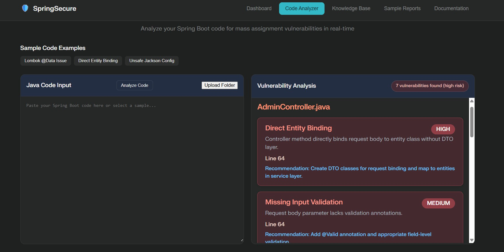

# Web interface

Paper Fig. 6: "Web interface output for AdminController.java: two HIGH Direct
Entity Binding findings and two MEDIUM Missing Input Validation findings,
each mapped to the affected line with an inline fix."

## What it is

The web interface is a secondary delivery mode for the same static analysis.
The code lives in `web/` (`index.html`, `app.js`, `style.css`); open
`index.html` in a browser to use it.

## Status

The web version is archived and superseded by the CLI tool in the repository
root, which offers better performance, batch processing, CI/CD integration,
multiple output formats, and proper Java AST parsing. For production use, use
the CLI (`node cli.js`) instead. The paper covers the web interface in one
sentence (§4.5) for this reason.
